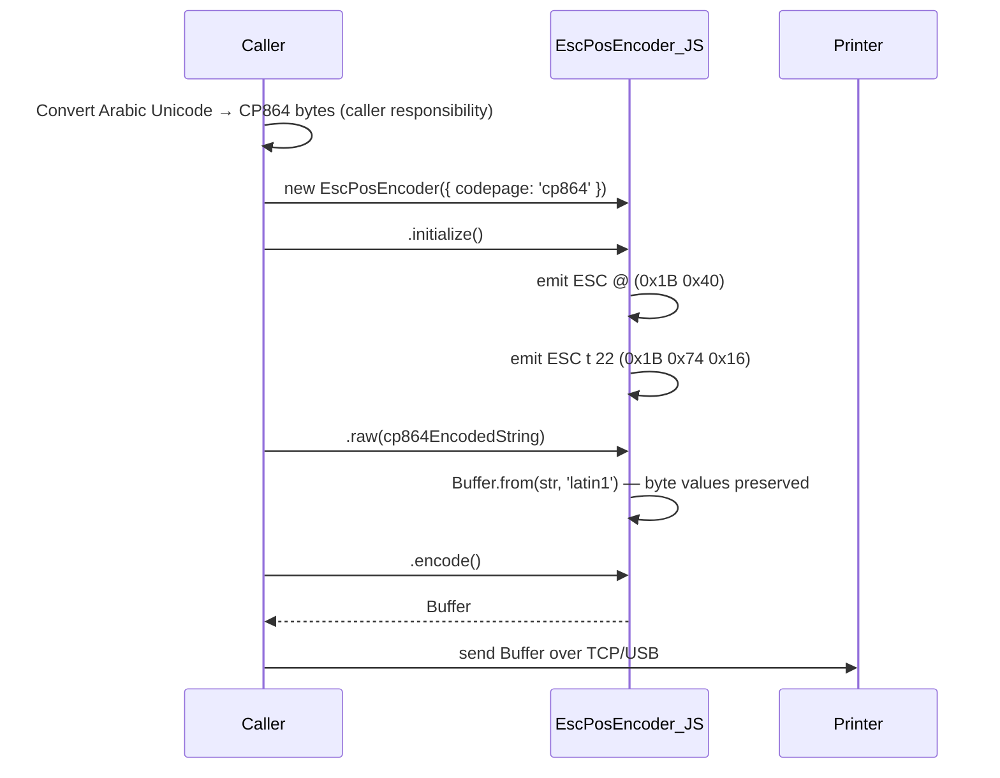
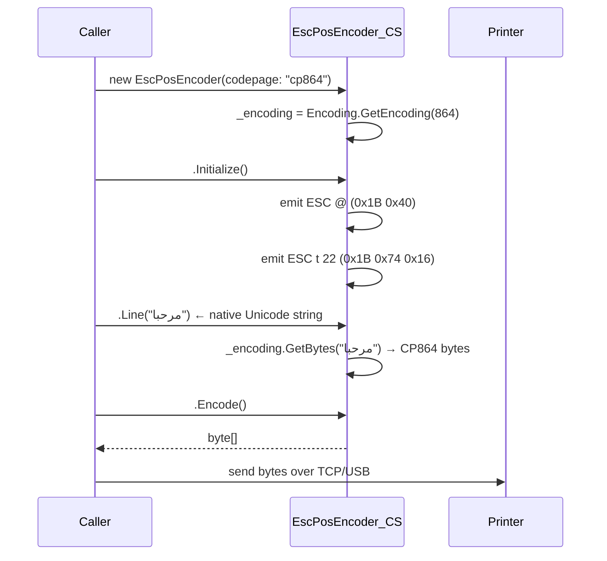

# Design Document: Arabic CP864 Support

## Overview

This feature adds CP864 (Code Page 864) as a recognized encoding in both the JavaScript ESC/POS encoder (`src/escpos.js`) and the C# native encoder (`src-native/EDPrintTool/EscPosEncoder.cs`). CP864 is the standard Arabic code page for Epson and Star Micronics thermal printers, activated via `ESC t 22` (byte `0x16`).

The change is deliberately minimal: adding one entry to each codepage registry, updating the C# `PrinterSettings` comment, adding a comment to printer profiles, and updating the `printEscPos` action so the encoder receives the configured codepage. No new classes, no new files, no new abstraction layers.

A key design decision is that the **JavaScript layer does not perform Unicode-to-CP864 conversion**. Node.js ships without a native CP864 encoder, and adding a third-party dependency (e.g. `iconv-lite`) would be a separate, larger change. Instead, the JS encoder continues to pass bytes through using `latin1` (a transparent 1:1 byte-value pass-through), placing the responsibility on the caller to supply correctly mapped byte values. The **C# layer**, by contrast, uses `System.Text.Encoding.GetEncoding(864)` and performs full Unicode-to-CP864 conversion automatically.

## Architecture

The feature touches four files across two execution environments:

```
JavaScript (Node.js / Electron renderer)
  src/escpos.js            — CODEPAGES registry + latin1 pass-through
  src/printer.js           — DEFAULT_SETTINGS codepage field (comment update only)
  src/printer-profiles.js  — epson/generic profile comment update
  src/actions.js           — printEscPos action: pass codepage to encoder

C# (.NET / Windows native tool)
  src-native/EDPrintTool/EscPosEncoder.cs           — Codepages dictionary + GetEncoding(864)
  src-native/EDPrintTool/Models/PrinterSettings.cs  — Codepage property comment update
```

Data flow for an Arabic print job (JS path):



Data flow for an Arabic print job (C# path):



## Components and Interfaces

### 1. `CODEPAGES` constant — `src/escpos.js`

Add one entry:

```js
const CODEPAGES = {
  cp437:  0,
  cp850:  2,
  cp858: 19,
  cp860:  3,
  cp863:  4,
  cp865:  5,
  cp1252: 16,
  cp864:  22,   // Arabic (Epson ESC t argument 22)
};
```

The `codepage(name)` method already handles any name present in `CODEPAGES` without modification. The `initialize()` method already emits `ESC t n` when a codepage is provided at construction. No method-level changes are required.

The `_textEncoding` field remains `'latin1'` for all codepages. For CP864 this is intentional: `latin1` maps bytes 0x00–0xFF to Unicode codepoints U+0000–U+00FF unchanged (a transparent 1:1 pass-through), so pre-converted CP864 byte values survive the `Buffer.from(str, 'latin1')` call intact.

### 2. `Codepages` dictionary — `src-native/EDPrintTool/EscPosEncoder.cs`

Add one entry:

```csharp
public static readonly Dictionary<string, (byte escArg, int dotnetCp)> Codepages = new()
{
    ["cp437"]  = (0,  437),
    ["cp850"]  = (2,  850),
    ["cp858"]  = (19, 858),
    ["cp860"]  = (3,  860),
    ["cp863"]  = (4,  863),
    ["cp865"]  = (5,  865),
    ["cp1252"] = (16, 1252),
    ["cp864"]  = (22, 864),   // Arabic (Epson ESC t argument 22)
};
```

The `Codepage(string name)` method already calls `Encoding.GetEncoding(info.dotnetCp)`, so it will resolve `Encoding.GetEncoding(864)` automatically. `CodePagesEncodingProvider.Instance` is already registered in the constructor, so CP864 will be available at runtime on any .NET platform.

If `Encoding.GetEncoding(864)` throws (e.g. on a stripped runtime), the existing constructor code propagates the exception. The requirement to throw an `InvalidOperationException` with a descriptive message is handled by wrapping the call.

### 3. `DEFAULT_SETTINGS` — `src/printer.js`

Update the comment on the `codepage` field to include `'cp864'`:

```js
codepage: '',  // '' = printer default, or 'cp437','cp850','cp858','cp1252','cp864'
```

No logic changes. The settings object is an open string field; the system already accepts any string value without validation, so `'cp864'` is persisted and round-tripped without additional code.

### 4. `PrinterSettings.cs` — `src-native/EDPrintTool/Models/PrinterSettings.cs`

Update the XML comment on the `Codepage` property:

```csharp
[JsonPropertyName("codepage")]
public string Codepage { get; set; } = ""; // "" = printer default, or "cp437","cp850","cp858","cp1252","cp864"
```

### 5. Printer profiles — `src/printer-profiles.js`

Add a comment to the `epson` and `generic` profiles noting `cp864` as a valid `defaultCodepage` for Arabic-capable printers:

```js
defaultCodepage: 'cp437',  // use 'cp864' for Arabic-capable Epson TM printers
```

### 6. `printEscPos` action — `src/actions.js`

The current `printEscPos` handler constructs `EscPosEncoder` without passing a codepage:

```js
const encoder = new EscPosEncoder({ paperWidth: s.paperWidth });
```

This must be updated to pass the printer's configured codepage:

```js
const encoder = new EscPosEncoder({ paperWidth: s.paperWidth, codepage: s.codepage || null });
```

This is the only logic change in `actions.js`. It ensures that when a printer is configured with `codepage: 'cp864'`, the `printEscPos` action emits `ESC t 22` before the command stream.

## Data Models

### Codepage registry entries

| Name    | ESC t arg | JS Buffer encoding | .NET codepage |
|---------|-----------|--------------------|---------------|
| cp437   | 0         | latin1             | 437           |
| cp850   | 2         | latin1             | 850           |
| cp858   | 19        | latin1             | 858           |
| cp860   | 3         | latin1             | 860           |
| cp863   | 4         | latin1             | 863           |
| cp865   | 5         | latin1             | 865           |
| cp1252  | 16        | latin1             | 1252          |
| **cp864** | **22**  | **latin1**         | **864**       |

### Printer settings (JS)

The `codepage` field in `DEFAULT_SETTINGS` is a free string. Valid recognized values after this change:

```
'' | 'cp437' | 'cp850' | 'cp858' | 'cp860' | 'cp863' | 'cp865' | 'cp1252' | 'cp864'
```

Unrecognized values cause `EscPosEncoder.codepage()` to fall back to argument `0` (cp437), consistent with existing behavior (Requirement 5.4).

### CP864 character mapping (partial, for documentation)

Arabic characters in CP864 occupy bytes `0xA0`–`0xFF`. A few reference mappings:

| Unicode | CP864 byte | Arabic letter |
|---------|-----------|---------------|
| U+0621  | 0xC1      | ء (HAMZA)     |
| U+0627  | 0xC7      | ا (ALEF)      |
| U+0628  | 0xC8      | ب (BA)        |
| U+062A  | 0xCA      | ت (TA)        |
| U+0644  | 0xE4      | ل (LAM)       |
| U+0645  | 0xE5      | م (MEEM)      |

JS callers must perform this mapping themselves (e.g. via `iconv-lite` or a lookup table) before passing strings to the encoder.


## Correctness Properties

*A property is a characteristic or behavior that should hold true across all valid executions of a system — essentially, a formal statement about what the system should do. Properties serve as the bridge between human-readable specifications and machine-verifiable correctness guarantees.*

### Property 1: JS latin1 byte pass-through

*For any* byte array of length N with values in the range 0x00–0xFF, constructing a string from those bytes using `latin1` encoding and then calling `Buffer.from(str, 'latin1')` SHALL produce a buffer whose byte values are identical to the original input array.

This validates that the `raw()` and `line()` methods preserve pre-converted CP864 byte values without corruption when `cp864` is the active codepage.

**Validates: Requirements 1.4, 4.1**

### Property 2: ESC t 22 prefix for any content

*For any* non-empty content string, when an `EscPosEncoder (JS)` is initialized with `codepage: 'cp864'`, the encoded output buffer SHALL contain the byte sequence `[0x1B, 0x74, 0x16]` at a position before the content bytes.

This holds regardless of what content follows, validating that the codepage selection byte is always emitted as part of the setup sequence.

**Validates: Requirements 1.2, 1.3, 3.2, 5.3**

### Property 3: C# CP864 encoding round-trip

*For any* string composed entirely of characters that have a mapping in CP864, encoding the string via `EscPosEncoder (CS)` with `codepage: "cp864"` (which uses `Encoding.GetEncoding(864)`) and then decoding the resulting bytes with `Encoding.GetEncoding(864)` SHALL produce a string equal to the original input.

**Validates: Requirements 4.4**

### Property 4: Printer settings codepage round-trip

*For any* valid codepage string value (including `'cp864'`), storing that value via `updatePrinterSettings` and then reading it back via `getPrinter` SHALL return a settings object whose `codepage` field equals the stored value.

**Validates: Requirements 5.1**

### Property 5: Unrecognized codepage does not throw

*For any* string that is not a key in `CODEPAGES`, calling `encoder.codepage(unknownName)` on an `EscPosEncoder (JS)` instance SHALL NOT throw an exception, and the resulting encoded buffer SHALL NOT contain an `ESC t` byte sequence.

**Validates: Requirements 5.4**

## Error Handling

### JS encoder — unrecognized codepage

The existing `codepage(name)` method uses `CODEPAGES[name] ?? 0`. After adding `cp864`, the fallback to `0` (cp437 argument) for completely unknown names is preserved. Requirement 5.4 explicitly requires this silent-fallback behavior for backward compatibility.

An `ESC t 0` byte being emitted for unknown codepages is a pre-existing behavior. The design retains it: callers with typos (e.g. `'cp8864'`) get cp437 behavior rather than an error.

### C# encoder — CodePages not registered

`Encoding.GetEncoding(864)` requires either:
- .NET Framework (which includes it by default), or
- .NET Core / .NET 5+ with `Encoding.RegisterProvider(CodePagesEncodingProvider.Instance)` called first.

The constructor already calls `Encoding.RegisterProvider(CodePagesEncodingProvider.Instance)` before resolving any codepage. If registration succeeds but the encoding is still unavailable (e.g. a severely stripped runtime), `GetEncoding(864)` will throw a `NotSupportedException`. This exception should be caught and re-thrown as an `InvalidOperationException` with a message pointing to the `System.Text.Encoding.CodePages` NuGet package — per Requirement 2.4.

### Settings persistence — no validation

The `codepage` field in printer settings is stored as a raw string with no server-side validation. Unrecognized values are silently accepted on write; they only produce the cp437 fallback behavior at print time. This is consistent with the existing design for all other string settings fields.

## Testing Strategy

### Dual approach

Unit tests cover specific examples and edge cases. Property-based tests cover universal behaviors across generated inputs.

**Property-based testing library**: `fast-check` (JS) and `FsCheck` (C#, via xUnit).

### Unit tests (example-based)

**JS — `src/escpos.js`**

- `CODEPAGES` contains `cp864: 22`
- `codepage('cp864')` emits `[0x1B, 0x74, 0x16]`
- `new EscPosEncoder({ codepage: 'cp864' }).initialize()` emits `[0x1B, 0x40, 0x1B, 0x74, 0x16]`
- `buildEscPosPayload` with `cp864` settings includes `ESC t 22` in output

**C# — `EscPosEncoder.cs`**

- `Codepages["cp864"]` equals `(22, 864)`
- `Codepage("cp864")` emits `[0x1B, 0x74, 0x16]`
- Constructor with `"cp864"` sets encoding to CP864 (verify by encoding a known Arabic char)
- Known Arabic string `"مرحبا"` encodes to expected CP864 byte sequence

**Settings / API**

- `addPrinter` with `codepage: 'cp864'` stores without error
- `updateSettings` with `{ codepage: 'cp864' }` returns updated printer with `codepage: 'cp864'`
- `printEscPos` action constructs encoder with printer's codepage

### Property-based tests

Each test runs a minimum of 100 iterations.

**Property 1 — JS latin1 byte pass-through**
Tag: `Feature: arabic-cp864-support, Property 1: JS latin1 byte pass-through`
- Generator: arbitrary `Uint8Array` of length 1–200
- Assertion: `Buffer.from(String.fromCharCode(...bytes), 'latin1')` equals original bytes

**Property 2 — ESC t 22 prefix for any content**
Tag: `Feature: arabic-cp864-support, Property 2: ESC t 22 prefix for any content`
- Generator: arbitrary non-empty strings (ASCII + extended)
- Setup: `new EscPosEncoder({ codepage: 'cp864' }).initialize().raw(content).encode()`
- Assertion: buffer contains `[0x1B, 0x74, 0x16]` at index before any content bytes

**Property 3 — C# CP864 encoding round-trip**
Tag: `Feature: arabic-cp864-support, Property 3: C# CP864 encoding round-trip`
- Generator: random strings from the set of CP864-encodable Arabic characters (U+0621–U+064A range, filtered to those with CP864 mappings)
- Assertion: `Encoding.GetEncoding(864).GetString(encoder.Encode().Skip(headerBytes).ToArray()) == original`

**Property 4 — Printer settings codepage round-trip**
Tag: `Feature: arabic-cp864-support, Property 4: Printer settings codepage round-trip`
- Generator: arbitrary strings from the set of known valid codepage names (cp437, cp850, cp858, cp860, cp863, cp865, cp1252, cp864)
- Assertion: `getPrinter(id).settings.codepage === storedValue`

**Property 5 — Unrecognized codepage does not throw**
Tag: `Feature: arabic-cp864-support, Property 5: Unrecognized codepage does not throw`
- Generator: arbitrary strings not in `CODEPAGES` (filter out known keys)
- Assertion: `encoder.codepage(name)` does not throw; output does not contain `ESC t`
